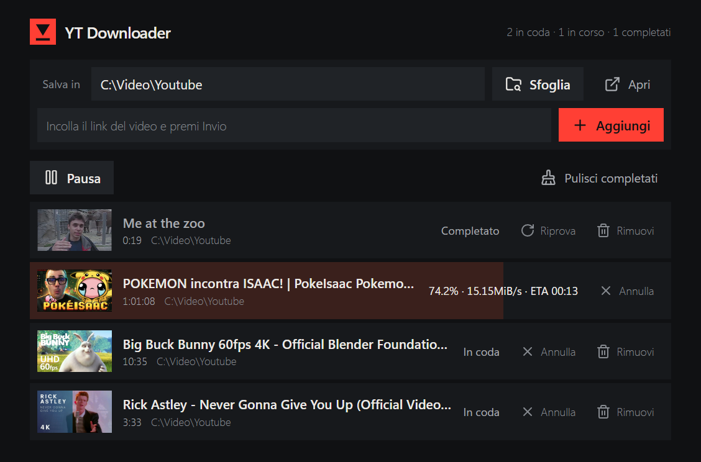

<p align="center">
  
</p>

<h1 align="center">YT Downloader</h1>

<p align="center">
  Una coda di download per YouTube, semplice e veloce.<br>
  Incolli i link, premi <b>Avvia coda</b> e i video si scaricano uno per volta alla qualità massima.
</p>

<p align="center">
  <a href="../../releases/latest"></a>
  
  
</p>

<p align="center">
  
</p>

## Cosa fa

- **Coda di download.** Aggiungi quanti link vuoi, poi avvia: li scarica uno alla volta, senza che tu debba stare lì.
- **Qualità massima.** Usa [yt-dlp](https://github.com/yt-dlp/yt-dlp) con `bestvideo+bestaudio/best` e unisce video e audio in un unico **MP4** con [ffmpeg](https://ffmpeg.org).
- **Anteprima di ogni video.** Copertina, titolo e durata compaiono appena incolli il link.
- **Cartella di destinazione globale.** La scegli una volta e vale per tutti i video che aggiungi da quel momento. Se la cambi, i video già in coda restano dove erano e quelli nuovi vanno nella nuova cartella.
- **Avanzamento in tempo reale.** Percentuale, velocità e tempo rimanente per il video in corso.
- **Pausa, annulla, riprova, rimuovi.** La coda viene salvata: se chiudi l'app a metà, riparte da dove era rimasta.
- **Si installa da solo i pezzi che mancano.** All'avvio controlla `yt-dlp` e `ffmpeg` e, se non ci sono, li installa: con `winget` su Windows, scaricandoli in una cartella tua su Linux (senza `sudo`).
- **Windows e Linux.** Stesso programma, stessa interfaccia.

## Installazione

### Windows: file `.exe` (consigliato)

1. Vai alla pagina delle [**Releases**](../../releases/latest) e scarica `YT-Downloader.exe`.
2. Fai doppio clic. Si apre una finestra con l'app e una console che mostra i controlli iniziali; a controlli finiti la console si riduce a icona nella barra delle applicazioni.
3. Al primo avvio, se mancano `yt-dlp` o `ffmpeg`, li installa da solo (serve `winget`, già presente su Windows 10/11 aggiornati). Può chiedere conferma per l'installazione.

Per chiudere l'app, chiudi la finestra della console ridotta a icona (clic destro sull'icona nella barra delle applicazioni, poi *Chiudi finestra*).

> **Windows mostra "Windows ha protetto il PC"?** L'eseguibile non è firmato digitalmente. Clicca su **Maggiori informazioni** e poi su **Esegui comunque**.

I tuoi dati stanno in `%APPDATA%\YT Downloader` (coda e impostazioni). I video, se non scegli altro, vanno in `Video\YT Downloader`.

### Linux: file `.tar.gz`

1. Dalla pagina delle [**Releases**](../../releases/latest) scarica `YT-Downloader-linux-x64.tar.gz` (Linux a 64 bit, architettura x86-64).
2. Estrai ed esegui. L'archivio conserva già il permesso di esecuzione, quindi non serve `chmod`:

   ```bash
   tar xzf YT-Downloader-linux-x64.tar.gz
   ./YT-Downloader
   ```

3. Al primo avvio scarica da solo `yt-dlp` e `ffmpeg` (circa 100 MB in tutto) in `~/.local/share/YT Downloader/bin`, senza bisogno di `sudo`. Se li hai già installati nel sistema, usa quelli.
4. La finestra dell'app si apre con Chrome, Chromium, Edge o Brave, se ne trova uno; altrimenti con il browser predefinito. Per fermare l'app premi `Ctrl+C` nel terminale.

Il pulsante **Sfoglia** usa `zenity` o `kdialog`. Se non ne hai installato nessuno, scrivi il percorso della cartella a mano nel campo. I dati stanno in `~/.local/share/YT Downloader` e i video, se non scegli altro, in `~/Videos/YT Downloader`.

> Testato su Ubuntu (WSL) per avvio, download e annullamento. L'apertura della finestra e il selettore di cartelle dipendono dal tuo desktop. Altre architetture (come ARM) e macOS non sono supportate dal file pronto.

### Dal codice sorgente

Servono [Node.js](https://nodejs.org) 18 o successivo e [Yarn](https://yarnpkg.com), su Windows o Linux.

```bash
git clone https://github.com/DevEn-Debug/ytdownloader.git
cd ytdownloader
yarn dev
```

L'app si apre da sola. Non ci sono dipendenze da installare per usarla: `yarn install` serve solo per creare l'`.exe`.

## Come si usa

1. Controlla (o cambia) la cartella in **Salva in**: con **Sfoglia** ne scegli un'altra, con **Apri** apri quella attuale nel gestore file.
2. Incolla il link di un video e premi **Invio** (o **Aggiungi**). Puoi incollare anche più link insieme.
3. Premi **Avvia coda**. Con **Pausa** la coda si ferma dopo il video in corso.
4. Su ogni video puoi **Annullare**, **Riprovare** o **Rimuovere**. **Pulisci completati** svuota dalla lista quelli finiti.

Se incolli il link di un video dentro una playlist, viene scaricato solo quel video.

## Creare gli eseguibili

```bash
yarn install
yarn build          # Windows: dist/YT-Downloader.exe
yarn build:linux    # Linux x64: dist/YT-Downloader-linux-x64.tar.gz (anche da Windows)
yarn build:all      # entrambi
```

Il risultato è un unico file per sistema (circa 90 MB l'`.exe`, 42 MB l'archivio Linux) che contiene Node.js, il server e l'interfaccia, costruito con le [Single Executable Applications](https://nodejs.org/api/single-executable-applications.html) di Node. Il lavoro lo fa `scripts/build-exe.js`: unisce il codice con `esbuild`, incorpora i file della pagina, imposta l'icona e inietta tutto in una copia di Node. L'`.exe` si crea solo da Windows (serve per impostare l'icona). La versione Linux si crea anche da Windows: lo script scarica il Node ufficiale per Linux della stessa versione e ne verifica l'impronta SHA-256. Serve Node.js 22 o successivo.

## Impostazioni avanzate

Variabili d'ambiente, tutte facoltative:

| Variabile | Cosa fa | Predefinito |
| --- | --- | --- |
| `PORT` | Porta del server locale | `3000` |
| `DOWNLOAD_DIR` | Cartella dei video alla prima esecuzione | `downloads/` (sorgente) o `Video/YT Downloader` (eseguibile) |
| `DATA_DIR` | Dove salvare `queue.json` e `settings.json` | cartella del progetto (sorgente) o `%APPDATA%\YT Downloader` (`.exe`) o `~/.local/share/YT Downloader` (Linux) |
| `NO_OPEN` | Se impostata, non apre la finestra all'avvio | |

Il server ascolta solo su `127.0.0.1`: non è raggiungibile da altri computer.

## Struttura

```
server.js            server HTTP, coda di download e integrazione con yt-dlp
lib/platform.js      differenze tra sistemi (selettore cartella, apertura finestra, processi)
lib/ensure-deps.js   controlla e installa yt-dlp e ffmpeg (winget su Windows, download su Linux)
public/              interfaccia (HTML, CSS, JavaScript, logo, icone)
scripts/             creazione dell'icona e degli eseguibili
```

## Uso responsabile

Scarica solo contenuti che ti appartengono, che hanno una licenza che lo permette o che hai il diritto di salvare. Il download di video può violare i termini di servizio di YouTube o il diritto d'autore, a seconda dei casi e del Paese: la responsabilità dell'uso è tua.

## Crediti

- [yt-dlp](https://github.com/yt-dlp/yt-dlp), che fa tutto il lavoro di download.
- [FFmpeg](https://ffmpeg.org), per unire video e audio.
- [Lucide](https://lucide.dev), per le icone (licenza ISC).

## Licenza

[MIT](LICENSE)
